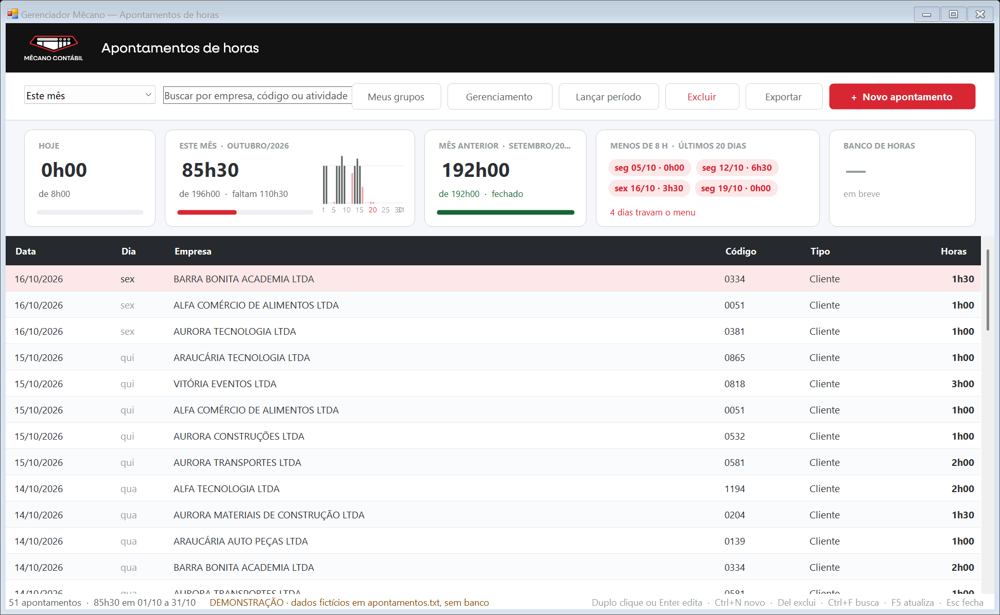
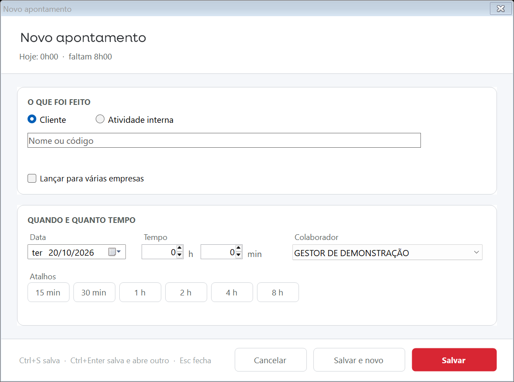
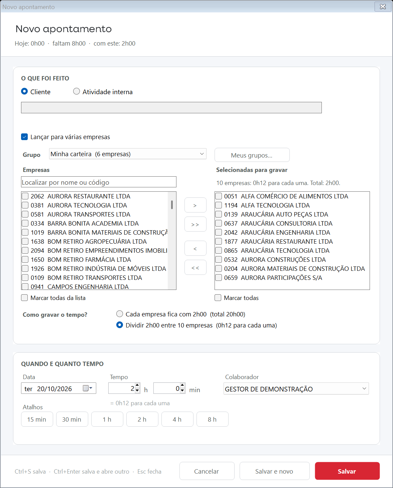
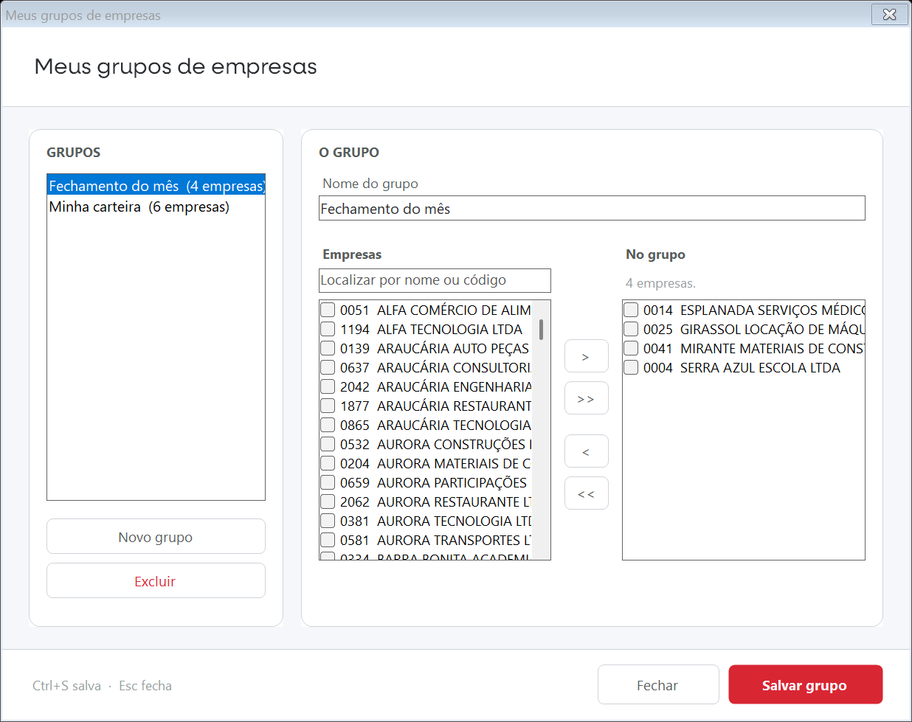
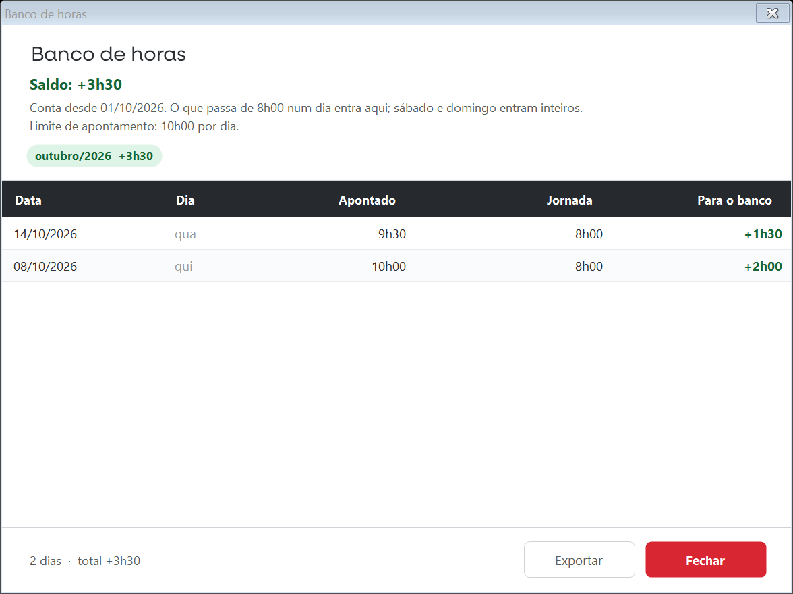

# Gerenciador Mêcano — Apontamentos de horas

Tela nova de **apontamento de horas** (o "Time") para o Gerenciador Mêcano, no visual das telas novas (login, Colaboradores, Explorer de Arquivos). Substitui as duas janelas antigas (Cadastro de Tempo e Consulta do Time) por uma tela só, e acrescenta três regras pedidas pela diretoria:

| Regra | Em uma frase |
|---|---|
| **Rateio entre empresas** | Ao lançar para várias empresas, a pessoa escolhe se cada uma recebe o tempo inteiro (como hoje) ou se o tempo é **dividido por igual** entre elas. |
| **Trava de 10 h por dia** | Ninguém grava mais de 10h00 de apontamento num dia. A tela avisa antes e recusa se passar. |
| **Aviso acima de 8h00** | Quem passa de 8h00 num dia é avisado na própria tela (subtítulo em vermelho e uma mensagem ao gravar), mas grava. |
| **Banco de horas (adiado)** | O cartão fica na tela sem número. A conta do que passa de 8h00 está pronta, desligada por uma chave (`BancoHoras.ATIVO`), para não confundir com o banco do sistema de ponto. |

**Banco de dados: só uma tabela nova.** A tela grava na `TbTime` com as mesmas procedures de hoje. A única novidade é a `TbTimeGrupoEmpresa` dos grupos de empresas (script em `preprod\`); sem ela tudo o mais funciona.

Estado em 16/10/2026: pronta para **pré-produção** (banco `Grupo_Mecano_Testes`). Passo a passo em [IMPLANTACAO.md](IMPLANTACAO.md).

---

## 1. Para quem usa

### A tela

- **Período** (hoje, semana, mês, mês anterior, 30 dias ou datas livres) e **busca** por empresa, código ou atividade.
- **Cinco cartões**: HOJE · ESTE MÊS (com o gráfico dia a dia) · MÊS ANTERIOR · MENOS DE 8 H nos últimos 20 dias (um chip por dia; clicar no dia abre o lançamento já naquela data) · **BANCO DE HORAS** (adiado: sem número, "em breve").
- Lista dos lançamentos; duplo clique ou Enter edita, Del exclui com confirmação, botão direito tem "Novo apontamento nesta data".
- **Exportar** gera um CSV da lista filtrada, com total, que abre direto no Excel.

### Lançar horas

1. Escolha o **cliente** (a lista filtra conforme você digita, por nome ou código) **ou** uma **atividade interna** (férias, treinamento, sistemas…).
2. Informe a **data** (nunca futura) e o **tempo** em horas e minutos, ou use um atalho (15 min, 30 min, 1 h, 2 h, 4 h, 8 h).
3. **Salvar**, ou **Salvar e novo** (Ctrl+Enter) para lançar o dia inteiro sem fechar a janela.

Gestor e diretoria veem um campo a mais, **Colaborador**, para gravar em nome de outra pessoa (vem com o próprio nome). A trava de 10 h e o subtítulo passam a ser os do dia dela, e o lançamento não aparece na lista de quem gravou.

O subtítulo da janela acompanha o dia, só com os números: *"Hoje: 7h00 · faltam 1h00 · com este: 9h00 (1h00 no banco)"*.

### Várias empresas de uma vez

Marque **"Lançar para várias empresas"**, passe as empresas para a lista da direita e escolha, em **"Como gravar o tempo?"**:

- **Cada empresa fica com o tempo inteiro** — 2 h em 4 empresas = 8 h no dia (o comportamento do Time de hoje; é o padrão).
- **Dividir o tempo entre as empresas** — 2 h em 4 empresas = 0h30 para cada uma, 2 h no dia.

Em cima das listas há o campo **Grupo**: escolha um dos seus grupos e as empresas dele passam para a direita de uma vez. **Meus grupos…** abre a janela para montar os grupos (se já houver empresas selecionadas, ela abre com um grupo novo já preenchido).

As duas frases mostram os números reais assim que você informa o tempo e as empresas. A divisão é feita em centésimos de hora, a unidade que o Time grava, para a soma fechar exata (2 h em 3 empresas = 0,67 + 0,67 + 0,66). Se o tempo for pequeno demais para dividir, a tela avisa e não grava.

### Meus grupos de empresas

Cada pessoa monta quantos grupos quiser ("Minha carteira", "Fechamento do mês"…): um nome e as empresas, com a mesma busca e as mesmas setas do lançamento. O botão **Meus grupos** na barra da lista abre a janela; no lançamento com várias empresas, o campo **Grupo** usa o que foi montado. Os grupos são de quem os criou; ninguém vê os dos outros.

É a única parte da entrega que mexe no banco: uma tabela nova, `TbTimeGrupoEmpresa`, criada pelo script `preprod\2026-10-20-Grupos-de-Empresas.sql`. Sem a tabela, o botão e o campo somem e o resto funciona igual.

### Aviso de 8 h e trava de 10 h

- Quando o que você já tem no dia mais o que está digitando passa de **8h00**, o subtítulo fica vermelho: *"Hoje: 7h00 · com este: 9h00 · acima de 8h00"*. Ao gravar, aparece a mensagem *"Hoje ficou com 9h00, acima de 8h00."* O lançamento é gravado normalmente.
- O que você já tem no dia **mais** o que vai gravar não pode passar de **10h00**. Se passar, a tela recusa e explica: *"Você já tem 9h00 hoje. O limite é 10h00 por dia, então cabem mais 1h00."*

### Banco de horas (adiado)

Decisão de 19/10/2026: o banco de horas fica **adiado**, para a equipe não confundir com o banco oficial do sistema de ponto. O cartão BANCO DE HORAS continua na tela, sem número ("em breve"), e o clique não abre nada. A conta (o que passa de 8h00 em dia útil e de 4h00 no sábado, desde 01/10/2026) e o extrato acima já estão prontos; para ligar, basta trocar `BancoHoras.ATIVO` para `True` em `Apontamento.vb`.

### Para gestor e diretoria: o resto do menu Time

A hierarquia do menu **Apontamentos › Time** de hoje é reproduzida dentro da própria tela. Quem é gestor ou diretoria vê dois botões a mais na barra de cima:

| Item do menu de hoje | Onde fica agora |
|---|---|
| Anotações | O botão **Novo apontamento**. |
| Consulta | A própria lista, com período e busca. |
| Anotações Período | Botão **Lançar período** ([07-anotacoes-periodo.png](capturas/07-anotacoes-periodo.png)): escolha a pessoa, o intervalo e o motivo (Férias / Afastamento ou Licença maternidade). A janela mostra antes quantos dias e horas vai gravar, com a regra de hoje: 8h00 por dia útil, "Sabado" com 4h00, nada no domingo. Dias em que a pessoa já tem apontamento são pulados (a tela antiga duplicava). |
| Gerenciamento › Consulta Analítica | Botão **Gerenciamento**: uma tela só, com as quatro consultas em abas. Aba **Analítica** ([08](capturas/08-gerenciamento-analitica.png)): período, colaborador, empresa e "Mostrar" (tudo, só clientes, só atividades internas), uma linha por apontamento, total na barra de baixo e Exportar. |
| Gerenciamento › Sintética | Aba **Sintética** ([09](capturas/09-gerenciamento-sintetica.png)): horas somadas por empresa (ou atividade), colaborador e mês, com código, CNPJ e grupo. Filtros de período, colaborador, empresa ou atividade, grupo de empresas e "Mostrar". A opção **"Somar todos os colaboradores por empresa"** (o "Acumular por Empresa" de hoje, que vem marcado) deixa uma linha por empresa e mês. |
| Gerenciamento › Geral | Aba **Por funcionário** ([10](capturas/10-gerenciamento-por-funcionario.png)): para cada pessoa, horas **diretas** (em clientes), **indiretas** (atividades internas), total e os percentuais. Duplo clique numa pessoa abre a Sintética dela no mesmo período, como a tela antiga abre o detalhe. |
| Gerenciamento › Acumulada por Usuário e Data | Aba **Por usuário e data** ([11](capturas/11-gerenciamento-por-usuario-data.png)): total de horas de cada pessoa no intervalo, ao lado do esperado (8h00 por dia útil, 4h00 no sábado) e da diferença. Quem não lançou nada aparece com 0h00. Em vermelho quem ficou abaixo ou passou do esperado, como hoje. |
| Gerenciamento › Controle do Ponto | Fora desta entrega, como combinado. |

As quatro abas usam as mesmas procedures das telas antigas (`Time_GetByEmpresa*`, `Time_GetByEmpresaAcumulado*`, `Time_GetByDataTudoHorasCustoDireto/Indireto`, `Time_GetByEmpresaUsuario`) e a mesma escolha entre elas, então os totais batem. Toda aba tem Exportar (CSV com os totais e as horas também em decimal). As diferenças de apresentação em relação às telas antigas estão listadas no roteiro de teste do [IMPLANTACAO.md](IMPLANTACAO.md).

### O que continua igual

- Data não pode ser futura; tempo não pode ser zero; ou cliente ou atividade, nunca os dois.
- "Administrativo" nas atividades internas só aparece para gestor e diretoria.
- Cada pessoa vê só os próprios apontamentos.
- A **trava de horas** do menu principal (dias com menos de 8 h, mês anterior abaixo da meta) continua a mesma; a tela só a mostra nos cartões e avisa o menu quando algo é gravado.

---

## 2. Para quem implanta

### Arquivos

A pasta `preprod\` tem só o que entra no Gerenciador: os sete `.vb` abaixo, nada da demonstração.

| Arquivo | Entra no Gerenciador? | O que é |
|---|---|---|
| `preprod\Apontamento.vb` | **sim** → `Grupo_Mecano\Cadastro\` | Modelos: `Apontamento`, `ClienteResumo`, `ResumoHoras` (regra da trava de horas), `BancoHoras` (rateio, teto de 10 h e banco de horas). |
| `preprod\ModApontamento.vb` | **sim** → `Grupo_Mecano\App_Code\` | Acesso a dados SQL: procedures `Time_*`, `HorasMes_GetList`, `TbClientes`, `Outros.txt`, `AposGravar` → `Opl2.menuacesso()`. |
| `preprod\frmApontamentos.vb` | **sim** → `Grupo_Mecano\Cadastro\` | Tela principal (lista, cartões, período, busca, exportar). Tem `Abrir()` e `Embutir()`. |
| `preprod\frmApontamentoDet.vb` | **sim** → `Grupo_Mecano\Cadastro\` | Lançamento novo / alterar; várias empresas (mesmo tempo ou rateio); trava de 10 h; gestor lança em nome de outra pessoa. |
| `preprod\frmBancoHoras.vb` | **sim** → `Grupo_Mecano\Cadastro\` | Extrato do banco de horas (só leitura; dormente enquanto `BancoHoras.ATIVO` for False). |
| `preprod\frmApontamentoPeriodo.vb` | **sim** → `Grupo_Mecano\Cadastro\` | "Anotações por período": férias/afastamento no nome de outra pessoa (gestor e diretoria). |
| `preprod\frmGruposEmpresas.vb` | **sim** → `Grupo_Mecano\Cadastro\` | "Meus grupos de empresas": montar, renomear e excluir os grupos da pessoa. |
| `preprod\2026-10-20-Grupos-de-Empresas.sql` | **sim** → rodar no banco | Cria a `TbTimeGrupoEmpresa` (pode rodar mais de uma vez). |
| `preprod\frmGerenciamentoTime.vb` | **sim** → `Grupo_Mecano\Cadastro\` | "Gerenciamento do Time": as quatro consultas de gestão em abas (Analítica, Sintética, Por funcionário, Por usuário e data), só leitura, com exportação (gestor e diretoria). |
| `ModApontamentoDemo.vb` | não | Versão da camada de dados que lê e grava em txt, para a demonstração. Mesmos membros públicos do `ModApontamento`. |
| `DemoMain.vb`, `build-demo.rsp`, `Compilar-Demo.bat` | não | Ponto de entrada e compilação da demo com o `vbc` do .NET 4.8, sem Visual Studio. |
| `clientes.txt`, `colaboradores.txt`, `outros.txt`, `horasmes.txt`, `grupos.txt` | não | Dados da demo. Empresas e colaboradores **fictícios**; atividades e metas mensais reais. |
| `apontamentos.txt` | não (fora do Git) | Lançamentos da demo, gerados na primeira abertura em volta da data de hoje. Apague para recomeçar. |
| `capturas\*.png` | não | Telas em 150 % de DPI, geradas por `GM-Apontamentos-Demo.exe /captura <pasta>`. |
| `LEIA-ME.md` | não | Documentação técnica detalhada: regras, decisões, o que saiu, o que falta decidir. |
| `IMPLANTACAO.md` | não | Passo a passo de pré-produção e produção, com roteiro de teste. |

Dependências já entregues antes e que o Gerenciador precisa ter: `TemaMecano.vb` (tela de login), `UiMecano.vb` e `Colaborador.vb` (Colaboradores). A demo lê esses três direto de `..\TO-DO_Entrega-Cadastro-Colaboradores`.

Fora do Git, de propósito: `GM-Apontamentos-Demo.exe` (compile com `Compilar-Demo.bat`), `Neulis_Neue_Regular.otf` (fonte licenciada da marca; o Gerenciador já a tem) e `apontamentos.txt`.

### Como a demo funciona

`Compilar-Demo.bat` gera `GM-Apontamentos-Demo.exe`. Não precisa de banco nem de rede. Abrir o exe mostra a tela com dados fictícios; `GM-Apontamentos-Demo.exe /captura <pasta>` gera as capturas sem interação.

A mesma tela está embutida na demo da tela principal (`..\TO-DO_Proposta-Tela-Principal\GM-Tema-Completo-Demo.exe`, item "Apontamentos" da seção ROTINA e atalho "Horas" do Acesso rápido).

### Testes feitos

Sem interface, contra a camada de dados da demo (resultados em [LEIA-ME.md](LEIA-ME.md)):

- Rateio: 2 h em 4 → 0,50 × 4; 2 h em 3 → 0,67 + 0,67 + 0,66; 1 h em 7; 5 min em 20 empresas recusado.
- Gravação: 2 h divididas em 4 empresas gravam quatro linhas de 0,50 h; 1 h 30 "para cada" em 3 empresas grava três de 1,50 h.
- Trava: 10h00 + 1h00 recusado; 8h00 + 1h00 gravado com aviso do banco; 9h00 + 3h00 recusado; 9h00 + 1h00 fecha em 10h00; alterar uma linha de 1h00 para 2h00 num dia de 10h00 recusado.
- Banco: saldo recalculado bate com os dias do extrato.
- Período: duas semanas viram 12 dias (10 úteis de 8h00 e 2 sábados de 4h00, 88h00), domingos fora; a janela grava em nome da outra pessoa, pula os dias que ela já tinha e a lista da pessoa logada não mostra essas linhas.
- Analítica: "só clientes" + "só atividades internas" = "tudo"; filtro por colaborador devolve só as linhas dela; filtro por empresa devolve só o código escolhido.
- Sintética: o total de cada modo é igual ao da Analítica no mesmo modo; cada linha é a soma dos apontamentos daquela empresa, pessoa e mês; "somar por empresa" mantém o total e deixa uma linha por empresa e mês; filtros por colaborador, empresa, atividade e grupo conferidos contra a Analítica.
- Por funcionário: diretas = horas em clientes da Analítica, indiretas = horas internas; departamento e função vêm do cadastro; % diretas + % indiretas = 100.
- Por usuário e data: esperado de segunda a domingo = 44h00 e de segunda a sexta = 40h00; quem não lançou entra com 0h00; a regra do vermelho (abaixo, ou acima de 0,15 h) conferida nos limites.
- A tela: as quatro abas consultam o mesmo período e a grade mostra a quantidade certa de linhas; o duplo clique em Por funcionário abre a Sintética da pessoa.

O que **não** foi testado ainda: a compilação dentro do projeto `Grupo_Mecano` no Visual Studio e o uso com o banco SQL real. É o que a pré-produção vai cobrir.

---

## 3. Decisões em aberto (para a diretoria)

- **Quem vê o Gerenciamento e lança período**: a entrega restringe a gestor e diretoria. Hoje o menu libera as consultas (que trazem custo por hora) e o "Anotações Período" para analistas, assistentes e administrativo.

### Decididas em 19/10/2026

- **Banco de horas adiado**: cartão na tela sem número; a conta fica pronta e desligada (`BancoHoras.ATIVO = False`). Quando for ligado, confirmar o início (01/10/2026) e a regra do sábado (4h00).
- **Acima de 8h00**: a pessoa é avisada na tela e grava; a trava continua em 10h00.
- **Motivos do período**: ficam os dois de hoje. Atestado já existe como atividade interna no lançamento comum.
- O crédito do banco **não** alimenta o "Banco de Horas (Saldos)" do RH: esse controle não é feito pelo Gerenciador.
- **Várias empresas**: fica como está, abrindo em "cada empresa fica com o tempo inteiro"; a pessoa escolhe "dividir" quando quiser.
- **Retrabalho** sai de vez. A tela nova já não tem o campo; o `retrabalho.txt` só era lido pelas telas antigas, que saem do menu.
- O item **Consulta** do menu Time aponta para a tela nova (passo 2 do IMPLANTACAO.md).
- **Lançar para outra pessoa** entra, só para gestor e diretoria (campo Colaborador na janela de lançamento).

Detalhes, histórico e justificativas em [LEIA-ME.md](LEIA-ME.md). Mudanças por data em [CHANGELOG.md](CHANGELOG.md).
